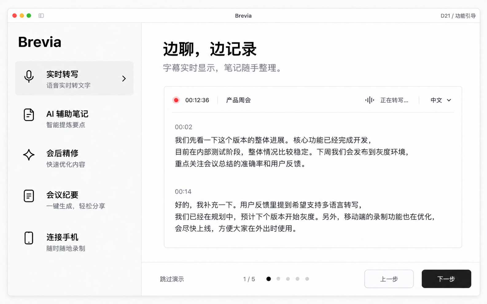

# Brevia 全页面设计图 · 2026-10-12

本轮重新设计桌面端与手机端的视觉语言、引导和完整功能页面。参考 [yovoice](https://github.com/leemysw/yovoice) 的真实工作台截图：白底、浅灰导航、细线分区、黑色主按钮与宽松阅读区。使用内置 imagegen 生成，未修改应用运行代码。

覆盖范围已确认：桌面端与手机端全部页面。“左右风格”按桌面左导航、右内容设计。共 38 张画板：26 张桌面画板、12 张手机流程画板，手机画板包含 39 个页面与状态。会议、人物、时间、配对码、容量和进度均为示例。图中的布局与状态供评审，精确功能边界、文案与尺寸以 [设计规范](design-specification.md) 为准。

## 第二轮修订

已按反馈修订 12 张既有画板，新增 3 张任务与侧栏状态画板。

1. 语言选择覆盖简中、英、西、日、韩、法、德、俄全部 8 种语言。
2. 模型引导按现有具体模型多选下载，模型与存储保持同一步，下载流程不变。
3. 会议库为手机采集会议增加“手机录音”图标与来源标识。
4. 实时会议不展示说话人姓名或头像；会后精修身份能力保留。
5. 实时侧栏自动收起，悬停或键盘焦点进入时恢复，补齐两种状态。
6. 补齐任务类型、进度、暂停、失败、最小化与堆叠设计。
7. 手机会议暂停、重点、结束改为纯图标按钮，深色与离线录音同步修订。

全部修订约束见[设计规范](design-specification.md)，生成记录见[第二轮提示词](revision-02-prompts.md)。

## 完整图册

### D01 欢迎与语言

### D02 权限引导

### D03 模型与存储 · 保存位置展开态

### D04 模型引导

### D05 会议库

### D06 工作区与空状态

### D07 录音准备

### D08 导入音频

### D09 实时会议

### D10 会议详情笔记纪要

### D11 逐字稿精修翻译

### D12 导出

### D13 设置总览

### D14 模型库

### D15 AI功能配置

### D16 进阶设置

### D17 声纹管理

### D18 手机连接

### D19 存储隐私更新

### D20 最近删除

### D21 功能引导

### D22 浮动字幕与深色

### D24 任务卡片 · 类型

### D25 任务卡片 · 状态与堆叠

### D26 实时侧栏 · 收起与悬停展开

### M01 手机引导

### M02 会议列表与准备

### M03 连接配对

### M04 现场录音

### M05 离线恢复补传

### M06 结束与会后回看

### M07 设置与设备

### M08 偏好后台隐私

### M09 异常与确认

### M10 分享离线和更新

### M11 系统与深色

### D23 会议纪要

### M12 手动地址与连接帮助

## 页面来源与覆盖

桌面页面依据 `frontend/index.html`、`frontend/app.js`、`frontend/ui-components.js`、`frontend/workspaces.js`、`frontend/onboarding.js` 与 `frontend/floating-caption.html`。手机页面依据 `mobile/lib/main.dart`、`mobile/lib/app_update.dart` 与当前产品隐私文案；旧手机设计文档仅作为状态检查依据，实际实现优先。

| 功能与状态                                    | 画板               |
| --------------------------------------------- | ------------------ |
| 首次语言、权限、存储、模型、功能演示          | D01–D04、D21       |
| 会议库、搜索、工作区与空状态                  | D05、D06           |
| 录音来源、会议语言、翻译、导入                | D07、D08           |
| 现场转写、笔记、AI 建议、暂停、结束           | D09、M04           |
| 笔记、纪要、精修、翻译、搜索、音频回听        | D10、D11、D23、M06 |
| 导出、分享                                    | D12、M10           |
| 设置、模型下载/暂停、在线/本地 AI、权限与进阶 | D13–D16            |
| 声纹名单、录音样本、验证                      | D17                |
| 手机服务、配对、信任、连接状态                | D18、M03、M07、M12 |
| 存储路径、隐私、关于、更新、删除确认          | D19、M07、M08、M10 |
| 任务卡片、最小化、堆叠、侧栏悬停              | D24–D26            |
| 最近删除、恢复、永久删除                      | D20                |
| 浮动字幕、深色、系统录音状态                  | D22、M11           |
| 手机欢迎、说明、按需权限                      | M01                |
| 手机列表、离线或实时录音准备、空状态          | M02                |
| 离线录音、补传、中断与恢复                    | M05                |
| 手机结束保存、待上传、笔记、转写回看          | M06                |
| 语言、外观、后台、隐私二级页                  | M08                |
| 权限拒绝、配对过期、存储不足、结束确认        | M09                |

功能演示的五个步骤复用 D09、D11、D10、D18 的真实任务布局；D21 展示演示壳层。选择菜单、错误提示、确认弹层复用规范中的组件，不为每个选项另造页面。桌面设置从旧弹窗/卡片结构调整为连续设置页，这是新设计建议，尚未实现。

## 使用限制

- 这些是静态设计图，不是可运行页面或已测量的 UI；imagegen 的中文、图标、尺寸和局部布局可能有偏差。
- 示意二维码不能用于连接，状态、版本、文件容量与百分比不代表真实运行数据。
- 手机仍负责采集、保存、传输和回看，电脑负责 AI 推理；不新增手机模型、账号或订阅流程。
- iOS 系统状态示意不等于承诺已实现 Live Activity；Android 更新交互不能复用于 iOS。
- 历史 `docs/mobile-design` 图保留供追溯；本次方案完整存入独立目录。

提示词见 [PROMPTS.md](PROMPTS.md)。规范文件与画板名称一致，可分别打开大图检查。
